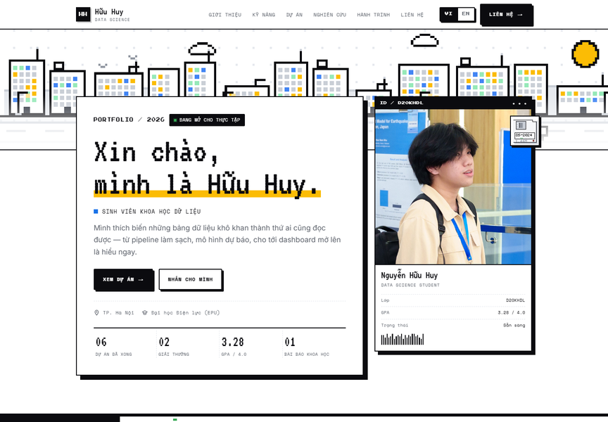

# Portfolio — Nguyễn Hữu Huy

Website portfolio cá nhân phong cách **pixel art lai Google web**: nền trắng, viền đen 2px,
đổ bóng cứng, font pixel tự host và các dải GIF ngang do chính script trong repo sinh ra.

- Next.js 16 (App Router) + React 19 + TypeScript
- Song ngữ **Tiếng Việt / English** (nút `VI | EN` ở header và footer, có lưu lựa chọn)
- Toàn bộ ảnh GIF pixel art được tạo bằng Python/Pillow, không cần tải asset từ ngoài
- Font tự host (VT323, Press Start 2P, Inter, Space Mono) — có đầy đủ dấu tiếng Việt



_Xem thêm: [nghiên cứu khoa học](docs/preview-research.png) · [My Productivity](docs/preview-productivity.png) · [Stuff I Make](docs/preview-stuff.png) · [card làm game](docs/preview-gamedev.png) · [toàn bộ trang chủ](docs/preview-full.png)._

## Chạy dự án

```bash
npm install
npm run dev      # http://localhost:3000
npm run build    # build production
npm run start    # chạy bản build
```

## Cấu trúc

```
app/
  layout.tsx          metadata, viewport, nạp CSS + <SiteShell>
  page.tsx            trang chủ
  productivity/       trang /productivity
  stuff-i-make/       trang /stuff-i-make
  globals.css         toàn bộ design system (token, layout, component, responsive)
  fonts.css           @font-face tự sinh, trỏ tới public/fonts
  icon.svg            favicon pixel "H"
components/
  site-shell.tsx    provider ngôn ngữ, progress bar, nút lên đầu trang, header + footer
  portfolio.tsx     nội dung trang chủ (ghép các section)
  lang-context.tsx  state ngôn ngữ + localStorage + ?lang=vi|en
  header.tsx        nav 6 mục (4 anchor + 2 trang), scroll-spy, menu mobile
  hero.tsx          banner GIF, thẻ giới thiệu, ID card với ảnh thật
  about.tsx         giới thiệu + thông tin nhanh + ảnh CRT
  skills.tsx        nhóm kỹ năng, thanh tiến trình pixel theo cuộn
  projects.tsx      bộ lọc dự án + dialog chi tiết (native <dialog>)
  research.tsx      nghiên cứu quốc tế: ảnh trao giải (mở lightbox), sơ đồ, BibTeX
  photo-viewer.tsx  thumbnail + lightbox xem ảnh full trong trang
  journey.tsx       timeline các cột mốc
  contact.tsx       email (copy được), mạng xã hội
  footer.tsx        ticker GIF + cột liên kết (đủ 8 mục)
  reveal.tsx        hiệu ứng xuất hiện khi cuộn (IntersectionObserver)
  pixel-cover.tsx   ảnh bìa dự án vẽ bằng SVG pixel
  productivity.tsx  trang My Productivity: kệ tech + setup theo năm
  desk-art.tsx      hình bàn làm việc pixel (SVG, tham số theo năm)
  stuff.tsx         trang Stuff I Make: sản phẩm + nút tải 3 nền tảng
lib/i18n.ts         TOÀN BỘ nội dung VI/EN (sửa nội dung ở đây)
public/gifs/        9 file GIF do scripts/make_gifs.py sinh ra
public/fonts/       woff2 tự host theo subset latin/latin-ext/vietnamese
public/assets/      ảnh thật: avatar + ảnh trao giải (web 1100px, large 2000px)
scripts/
  make_gifs.py      sinh lại toàn bộ GIF pixel (Pillow)
  fetch-fonts.py    tải lại font từ Google Fonts (chỉ cần khi đổi font)
```

## Các trang

| Đường dẫn | Nội dung |
|---|---|
| `/` | Trang chủ: hero, giới thiệu, kỹ năng, dự án, nghiên cứu, hành trình, liên hệ |
| `/productivity` | Tech dùng hằng ngày (kệ hàng: software, agent, CLI, code), setup 2022→2026, kênh YouTube nên xem — tông giấy vintage |
| `/stuff-i-make` | Phần mềm tự làm, nút tải Windows/macOS/Linux, danh sách đang làm |

Menu header có 6 mục: 4 anchor của trang chủ (Giới thiệu, Dự án, Nghiên cứu, Liên hệ)
và 2 trang con. Kỹ năng + Hành trình vẫn nằm trên trang chủ và trong menu footer.

Ảnh lễ trao giải bấm vào sẽ mở lightbox trong trang: ảnh lớn (`DSC02593-large.jpg`,
2000px) chỉ được tải khi mở, đóng bằng `Esc`, click nền hoặc nút X.

## Sửa nội dung

Mọi câu chữ nằm trong `lib/i18n.ts`, gồm hai object `vi` và `en` có cùng cấu trúc:
trang chủ (giới thiệu, kỹ năng, dự án, công bố khoa học, hành trình, liên hệ),
`productivity` (21 công cụ + 5 setup) và `stuff` (sản phẩm + đang làm).
Sửa một bên thì TypeScript sẽ báo nếu bên còn lại thiếu khoá tương ứng.

Thêm một công cụ vào kệ: thêm object vào `productivity.tools.items` (name, cat, letter,
color, price, since, desc, href). Thêm kênh YouTube: thêm vào `productivity.channels.groups`
(mỗi kênh cần name, handle, href). Thêm sản phẩm: thêm vào `stuff.items` với `downloads`
cho từng nền tảng — nút tải tự sinh.

Trang productivity dùng tông **vintage** (giấy ngà, mực nâu, dải màu ở đầu trang): toàn bộ
màu được khai báo trong khối `.page-vintage` ở `app/globals.css`, chỉ ảnh hưởng trang đó.
Độ thành thạo làm game (Godot, Unreal, Blender, Unity) nằm ở `skills.game` và hiện thành
một card rộng cuối mục Kỹ năng ở trang chủ.

Bài báo hiện có: **EPU-HEKV: Hierarchical External Memory for Bounded Active Reasoning**
(Asian Comnet 2026, Best Poster Award) — nằm trong `research.items`. Thêm bài mới bằng
cách thêm một phần tử vào mảng đó (mỗi bài tự render thành một card).

Thông tin cá nhân (tên, trường, lớp, GPA, ảnh) là thông tin thật. Phần **dự án, số liệu
trong paper (abstract, 42% token…), danh sách tech, sản phẩm Pixelpipe và link mạng xã hội**
vẫn là nội dung mẫu — nhớ thay bằng dữ liệu thật trong `lib/i18n.ts` trước khi deploy.
Link "Mua/Tải về" của kệ tech trỏ tới trang chủ thật của từng hãng; nút tải của Pixelpipe
đang trỏ tới `github.com/server-mode/pixelpipe/releases/latest` (chưa tồn tại).

## Tạo lại ảnh GIF / font

```bash
npm run assets   # cần Python 3 + Pillow; ghi đè public/gifs/*.gif
npm run fonts    # cần Internet; tải woff2 và ghi lại app/fonts.css
```

`scripts/make_gifs.py` vẽ ở lưới pixel logic (mỗi pixel = 5px thiết bị) bằng một bộ font
bitmap 5×7 tự viết, palette cố định, palette ảnh được lượng tử hoá nên GIF rất nhẹ
(tổng khoảng 0.87 MB cho 9 ảnh). Muốn thêm ảnh mới: viết hàm `b_ten_anh(t, n)` rồi
đăng ký trong `BUILDERS`.

## Ghi chú kỹ thuật

- **Ngôn ngữ**: mặc định `vi`; lựa chọn lưu ở `localStorage` (`hh-lang`); link
  `?lang=en` hoặc `?lang=vi` sẽ ưu tiên hơn, tiện chia sẻ.
- **Pixel sắc nét**: ảnh GIF dùng `image-rendering: pixelated`, kích thước đều là bội số của 5.
- **Truy cập**: skip link, `aria-pressed` cho nút ngôn ngữ/bộ lọc, dialog dùng `<dialog>`
  của trình duyệt (tự khoá focus và đóng bằng `Esc`), có `prefers-reduced-motion`.
- **Ảnh**: các GIF bên dưới màn hình đầu dùng `loading="lazy"`.
- **Dev**: chạy `npm run dev -- --port 3105` nếu cổng 3000 bận.

## Ghi công

Font: VT323, Press Start 2P, Inter, Space Mono (Google Fonts, OFL/Apache-2.0).
GIF, ảnh bìa SVG và toàn bộ giao diện được tạo trong repo này.

## Ảnh trong public/assets

- `DSC01358-2.jpg` — ảnh chân dung dùng cho thẻ ID ở hero.
- `DSC02593-web.jpg` — ảnh lễ trao giải Best Poster (thu nhỏ còn 1100px, ~171 KB).
- File gốc `DSC02593.jpg` (~20 MB) được gitignore để repo nhẹ. Khi thay ảnh mới, thu nhỏ lại bằng:

```bash
python -c "from PIL import Image; im = Image.open('public/assets/DSC02593.jpg'); w = 1100; im.resize((w, round(im.size[1]*w/im.size[0])), Image.LANCZOS).save('public/assets/DSC02593-web.jpg', quality=84, optimize=True, progressive=True)"
```

